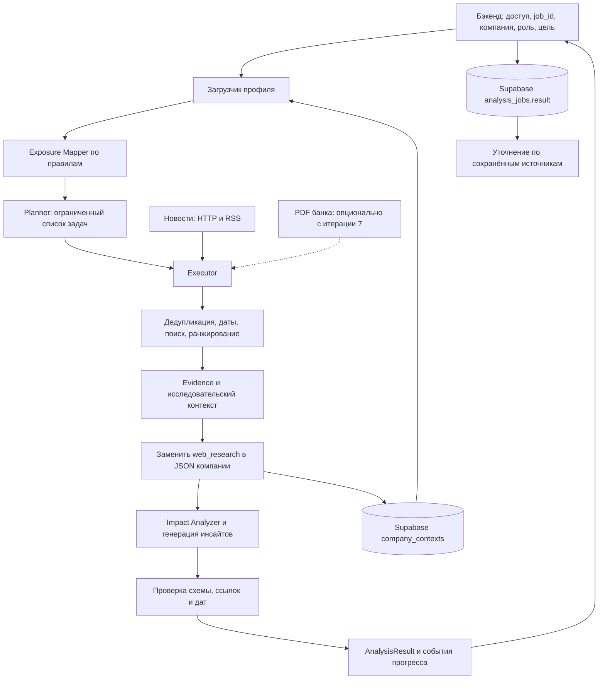

# План реализации ML части

Рекомендация: сначала построить один управляемый исследовательский pipeline без отдельного Judge. Он получает готовый профиль, строит карту факторов, планирует поиск, собирает доказательства и формирует проверяемые инсайты для бэкенда. Деление на Company Research и Insight Engine сохранить в структурах данных; два самостоятельных планировщика с повторным поиском на первом этапе не нужны.

Документ подготовлен 24 октября 2026 года по исходникам, материалам кейса и чтению схемы Supabase; последовательность и хранение контекста обновлены 25 октября по запросу пользователя. Это план следующих итераций, а не отчёт о реализованном сервисе. Точные существующие таблицы и новые предлагаемые форматы описаны в [DATA_CONTRACTS.md](DATA_CONTRACTS.md), задания для реализации — в [CODEX_PROMPTS.md](CODEX_PROMPTS.md).

## 1. Что в исходной архитектуре сохранить и изменить

| Решение из наброска | Предлагаемое изменение | Зачем |
| --- | --- | --- |
| Готовый JSON и `get_company_profile` | Сохранить; сначала JSON-адаптер, затем Supabase под тем же интерфейсом в одной итерации | Базовый контекст уже рассчитан |
| Exposure Mapper | Сохранить правилами и вынести правила в версионируемый конфиг | Можно объяснить связь поиска с признаком |
| Отдельные Company Research и персональный агент | На MVP один проход; общий исследовательский контекст и отдельная роль при ранжировании/интерпретации | Избежать двойной оплаты поиска и LLM |
| Planner → Executor → Impact Analyzer | Сохранить как обычные Python-компоненты с типизированными входами/выходами | Это и есть реализуемая собственная агентная логика |
| Отдельный генератор инсайтов после Impact Analyzer | Сначала один структурированный вызов анализа и генерации | Меньше потерь между пересказами и дешевле |
| Judge и Repair | Отложить семантического Judge; проверки формата, ссылок и дат оставить с первого результата | Без Judge не означает без контроля данных |
| News service | Сначала модуль и endpoint внутри одного ML-сервиса | Не нужен отдельный deploy и лишний сетевой hop |
| Глобальная индексация всех новостей | Начать с небольшого обновляемого корпуса, расширяемого провайдерами | Не строить новостной агрегатор до проверки полезности |
| Поиск по контрагентам | Искать по известным признакам контрагента; ID использовать только внутри датасета | Данные обезличены, реального названия компании нет |
| Дописывать исследования в company JSON | Хранить текущий расширенный контекст в `payload.web_research`, позже — в `payload.alfa_analytics`; при обновлении заменять соответствующий блок | Базовая подготовка выполняется один раз; JSON компании хранит актуальное исследование, а result задания — его снимок |
| PDF-аналитика банка | Подключить в итерации 7 после первых веб-инсайтов, отдельным отключаемым provider | Первые результаты не зависят от доступности и разбора PDF |
| Новая таблица инсайтов | На MVP использовать существующий `analysis_jobs.result`, запись — через бэкенд | Таблица и JSONB-поле уже существуют |
| Кэш исследования на месяц | Разделить базовый профиль, новости, банковские документы и персональный результат | У них различная скорость устаревания |
| BM25 + embeddings + RRF + reranker | Начать с BM25 и явных фильтров; гибрид добавлять по измеренному выигрышу | Для небольшого корпуса сложность пока не оправдана |

Существующий `ml/src/api.py` — клиент LLM. Будущий HTTP-сервис назвать `service.py` или `http_api.py`: не создавать рядом одноимённый пакет `api/`, пока старый модуль не перенесён с сохранением совместимости.

## 2. Что материалы действительно требуют

PDF кейса, страницы 6–14, требует персонализации, аналитики банка, источников, агентного многошагового процесса, самопроверки, адаптации и уточняющего взаимодействия. Число агентов само по себе преимуществ не даёт. Приложение 3 перечисляет разрешённые модели; страница 12 указывает общий лимит команды 500 рублей в день.

Первый технический проход без Judge допустим как промежуточная итерация. Для полноценного решения необходимо добавить хотя бы ограниченную адаптацию к отсутствующим/противоречивым данным. Отдельный LLM-судья для этого не обязателен.

Матрица содержит 13 гипотез, а не обучающую разметку и не доказанные причинные связи. В памятке есть полезные вопросы и пересказы банковской аналитики, но они не заменяют первичные отчёты. В частности, вывод из названия непрочитанного отчёта не является позицией банка. Указания памятки про интерфейс, доступ жюри и другие действия команды — контекст требований, а не поручение менять фронтенд, публиковать сервис или выдавать доступы в рамках текущей ML-задачи.

Приложение 2 кейса даёт [папку аналитики банка](https://drive.google.com/drive/folders/15xZTLF1lZ65p6o5xpNA_fRbxjoV-UlG1?usp=sharing). В локальном `ml/context/` сейчас находится только PDF самого кейса, DOCX-памятка и XLSX. Первичные банковские PDF не найдены в этой папке; их содержимое в рамках аудита не проверялось. Загрузка первичных материалов — зависимость только итерации 7. Итерации 1–6 дают работающие инсайты на базовом профиле и веб-источниках без PDF. До подключения банка `bank_view.unavailable` — штатный режим; сам по себе он не делает веб-результат частичным.

Разрешённые в приложении 3 названия: Gemma 4 26B A4B, GLM-5.3-Flash, Qwen3.6 35B A3B, DeepSeek-V4.1-Flash, Qwen3-VL-30B-A3B-Instruct, Kimi-K2.6. Точные API ID, цены, поддержка JSON Schema и ограничения шлюза отдельно проверяются при реализации; не выводятся из маркетингового названия. Текущий код использует `deepseek/deepseek-v4.1-flash`. Разработка кода с Codex не означает использование Codex как runtime-компонента решения.

## 3. Минимальная архитектура

Код управляет стадиями, ограничениями, идентификаторами и инструментами. LLM выбирает вопросы внутри разрешённого набора возможностей и строит интерпретацию. В первой версии достаточно двух содержательных обращений к модели: план исследования и анализ отобранных evidence. Формирование стандартных поисковых шаблонов допускает детерминированный fallback при сбое Planner.

Дальше один цикл адаптации: обнаружить конкретный пробел → создать до двух дополнительных задач → повторить анализ только затронутых кандидатов. Он подключается после работающего pipeline, без изменения внешнего контракта.

## 4. Граница ML и бэкенда

**ML:** чтение и валидация базового профиля, exposures, веб-исследование, evidence, обновление `payload.web_research`, ранжирование, интерпретация, ограниченный чат, trace и бюджет. После первых инсайтов — PDF-provider и обновление `payload.alfa_analytics`. Getter профиля остаётся read-only; расширенный контекст сохраняет отдельный метод.

**Бэкенд:** аутентификация пользователя, право видеть компанию, числовой `companies.id`, создание `analysis_jobs.id`, хранение результата и истории диалога, обновление статуса для фронтенда.

Для первой интеграции ML возвращает результат по `POST /internal/analyze`. Для стадий внутри длительного запроса затем добавляется NDJSON endpoint `/internal/analyze/stream`: бэкенд читает события и сохраняет их своим соединением. ML-роль не получает лишние права к `demo_users` или `analysis_jobs`.

Альтернатива на будущее — ML-worker с узкими правами на задания и lease/heartbeat. Не начинать с неё: сейчас это потребует менять политику доступа и протокол владения заданиями. Также не заводить второй независимый job-store внутри ML, который будет расходиться с `analysis_jobs`.

## 5. Exposure Mapper и инструкция исследования

Exposure означает **возможную чувствительность**, а не уже установленное влияние новости. Правило возвращает исходный признак, механизм, необходимые уточнения и темы поиска. Порог и вес — инженерные гипотезы, которые затем проверяются на примерах.

| Наблюдаемый признак | Темы и механизм | Обязательная оговорка |
| --- | --- | --- |
| Кредитный продукт | Ставка, условия нового финансирования и рефинансирования | Неизвестны остаток, срок и фиксированная/плавающая ставка |
| Лизинг | Финансирование оборудования, инвестиционный спрос | Валютный канал только при подтверждении импортной техники/валютных условий |
| Депозиты | Доходность новых размещений, сроки ликвидности | Признак не доказывает текущий остаток и доступность свободных средств |
| Гарантии | Условия гарантий и исполнения контрактов | Госзакупки не следуют из наличия гарантии |
| Факторинг | Стоимость оборотного финансирования и условия расчётов | Не является доказательством просрочек или кассового разрыва |
| ФТС и страны | Регулирование торговли, валютный и логистический каналы | Неизвестны направление, объём, актуальность торговли и валюта договора |
| ОКВЭД | Отраслевой спрос, ресурсы, регулирование | Детализировать деятельность; отрасль не задаёт всю бизнес-модель |
| Численность и зарплатный проект | Рынок труда и стоимость персонала | Зарплатный проект сам по себе не говорит о большом штате |
| Регион регистрации | Региональные события как кандидаты | Регистрация не доказывает размещение производства или маршрут поставок |
| Платёжные концентрации | Отрасль/регион крупных контрагентов, возможная передача воздействия | Платёж не доказывает отношения «поставщик/покупатель» |
| Общая группа | Связанные отрасли и внутренние потоки | Группа не раскрывает юридическую структуру; сумма выручки не консолидирована |
| Масштаб, стадия, возраст | Приоритизация и вопросы о финансировании | Возраст не доказывает закредитованность; масштаб не отдельная тема новости |
| Клиентский статус | Полнота контекста и допустимая форма действия | Не снижать значимость события только из-за статуса PROSPECT |

### Концентрация контрагентов

- Использовать пороги `> 0.30` и `> 0.50` как настраиваемые приоритеты исследования из заметок пользователя; на границах 0.30 и 0.50 поведение зафиксировать тестом.
- Рассматривать отдельно входящие и исходящие платежи, внутригрупповые и остальные связи. Один контрагент с долей 1.0 — формальная концентрация, но её смысл зависит от покрытия данных и типа потока.
- Для крупного контрагента получать известные ОКВЭД/регион из профиля. Если есть только `U_…`, не искать этот ID в интернете и не пытаться восстановить реальное лицо по комбинации признаков.
- `same_group=false` в нынешнем JSON означает отсутствие известного совпадения группы, а не доказанную независимость.
- Для точной доли вне группы нужен полный агрегат по платежам, а не вычитание из ограниченного top-10. Добавлять такую агрегацию отдельной итерацией, если она нужна для выбранного сценария.
- Приведённые пользователем медианы 58,7%/62,3% не пересчитывались в этом аудите; не использовать их как обученные пороги.

### Что агент должен установить

Пять вопросов из памятки становятся полями `research_questions`, а не поводом выдумывать ответы:

1. Как финансируется бизнес и какие условия неизвестны?
2. Где покупает/продаёт; что действительно известно о внешней торговле?
3. Кто формирует спрос; можно ли установить B2B/B2C/госконтракты?
4. Какие компоненты затрат подтверждены, а какие только предполагаются по отрасли?
5. Какие связи по платежам/группе делают чужую отрасль значимой?

Первоначальные отраслевые шаблоны: торговля; строительство с различием подрядчика и девелопера; промышленность; сырьё; добыча золота и ювелирное производство раздельно; сельское хозяйство/пища; транспорт; энергетика; IT/услуги; фарма/медицина. Выбирать детальные правила по реально встречающимся ОКВЭД. «Подрядчик по госзаказу» — подтверждаемое свойство, не автоматически отдельный ОКВЭД.

### Роли

| Код | Приоритеты интерпретации и действия |
| --- | --- |
| `cfo` | Денежный поток, стоимость финансирования, чувствительность маржи, сценарии |
| `treasurer` | Сроки ликвидности, валютные расчёты, размещения, условия рефинансирования |
| `ceo` | Спрос, непрерывность операций, инвестиции, контрагенты |
| `owner` | Устойчивость группы, распределение капитала, стратегические риски и возможности |
| `accountant` | Подтверждённые изменения отчётности, налогов, расчётов и сроков исполнения |
| `other_c_level` | Широкие операционные приоритеты; конкретную функцию уточнять через goal |
| `decision_maker` | Общие управленческие последствия и вопросы для профильного руководителя |

Роль меняет приоритет тем, вопросы и вывод, но не факты источника. `goal` уточняет задачу, а не даёт право LLM обходить ограничения инструментов.

## 6. Поиск, новости и аналитика банка

### Стартовый выбор

Сделать `NewsProvider.search(SearchTask)` и единую нормализованную выдачу. Основной провайдер веб-поиска — **Tavily Search API**, реализация `TavilySearchProvider` в промпте 4. RSS/HTTP и поиск по собранному корпусу — дополнительные источники. [Банк России публикует RSS-каналы](https://cbr.ru/development/RSS/) пресс-релизов и новостей; одного ЦБ для покрытия отраслевых сценариев недостаточно.

Использовать [Tavily Search](https://docs.tavily.com/documentation/api-reference/endpoint/search): ссылки и фрагменты из выдачи, затем собственный parser страниц. У пользователя уже есть ключ; читать его из `TAVILY_API` в корневом `.env` или окружении процесса, согласно `ml/.env.example`. В API он передаётся заголовком `Authorization: Bearer <ключ>`; ключ LLM-шлюза для этого не подходит. Использовать `include_answer=false` и собственную интерпретацию разрешённой моделью; внешний автономный research-agent не подключается. Без ключа доступны fixture/mock-проверки; live-поиск сообщает об отсутствии конфигурации, а не незаметно переключается на RSS. Ошибки квоты учитываются явно.

`/internal/news/search` возвращает **кандидаты с источниками**, а не инсайты. Новость не становится доказанным фактом только из-за попадания в search. Результаты с одним заголовком/сниппетом получают ограниченный статус; утверждения должны укладываться в реально прочитанный фрагмент.

### Поисковая задача

У задачи обязательны причина, exposure, источник, временное окно, фильтры и ожидаемый тип доказательства. Пример направления: «изменения стоимости нового кредитования для строительных компаний за окно анализа», а не «новости U_100044».

Один Planner получает компактный профиль и список exposures. В итерациях 1–6 он предлагает до шести задач только по веб-источникам. С итерации 7 поиск в банковском корпусе добавляется при включённом `ENABLE_BANK_ANALYTICS`; выключенный provider не создаёт задач и пробелов покрытия. Код назначает ID, ограничивает длины/лимиты, проверяет разрешённый `source_kind` и удаляет дубли. Executor не принимает SQL, shell-команды или произвольные URL, сгенерированные моделью.

### Evidence и ранжирование

Последовательность: нормализация URL → извлечение текста/метаданных → проверка дат → дедупликация документа → поиск → сопоставление с exposures → разнообразие событий → короткий набор evidence для LLM.

Для MVP использовать BM25 по русскому тексту с единообразной токенизацией и нормализацией, фильтрами периода и типа источника. Явные факторы ранга: совпадение exposure, роль, география при подтверждённой связи, свежесть, полнота текста, качество первоисточника. Веса — версионируемый baseline; отдельные факторы и причины сохранять. Схожие перепечатки одного события не считать независимыми подтверждениями.

### Банковские PDF после первых инсайтов

Это итерация 7, отдельное расширение работающего веб-MVP. По умолчанию `ENABLE_BANK_ANALYTICS=false`; отсутствие файлов и PDF-зависимостей не мешает веб-режиму.

Импортировать каждый документ один раз: manifest → хэш → текст по страницам → фрагменты с указанием страницы → индекс. Сохранять название, автора/подразделение при наличии, дату публикации, URL оригинала, локатор страницы, исходный фрагмент, признаки архива и версию парсинга.

Непрочитанные графики и сканы не превращать в выдуманные числа; помечать `needs_ocr`/`table_review`. Для первого MVP можно выбрать несколько отчётов с хорошо извлекаемым текстом, сохранив универсальный импорт остальных. Числа из критичных таблиц проверять по рендеру страниц.

Новая дата не всегда отменяет старый источник: сопоставлять показатель, горизонт, единицы и сценарий. Пересмотр прогноза одного показателя показывать как пересмотр. Противоречащие оценки разных показателей не «разрешать» простым выбором свежайшего документа. Архивные материалы не использовать для текущих цен и прогнозов.

## 7. Бюджет, время и кэш

Начальные лимиты ниже — предлагаемые настройки для пилота, а не измеренные гарантии:

| Параметр | MVP |
| --- | --- |
| Поисковые задачи | До 6 на исследование |
| Кандидаты | До 8 на задачу |
| Evidence для анализа | До 12, с лимитом размера фрагмента и общего контекста |
| Инсайты | До 5; допустим 0 |
| Содержательные LLM-вызовы | Planner и Impact Analyzer |
| Дополнительные LLM-вызовы | Не более 1 на исправление невалидного JSON, входит в общий лимит 3 |
| Токены на запуск | Начальный предел 24 000 суммарно input + output; резервировать output до вызова |
| Время запуска | Начальный deadline 120 секунд; измерить на шлюзе |
| Внешний запрос | Timeout, максимум 1 повтор временной ошибки в пределах общего deadline |
| Параллелизм извлечения | Начать с 2, ограничить отдельно для домена и LLM |
| Семантический Judge | Выключен |
| Адаптивный поиск | Выключен до итерации 10; затем максимум 1 круг и 2 задачи |

Один общий `BudgetManager` передаётся всем компонентам; повтор, fallback и уточняющий поиск также расходуют его. При включении адаптации общий лимит вызовов можно явно поднять до 4, сохранив общие ограничения времени и токенов. При нехватке ресурса вернуть частичный результат с причиной, а не запускать незапланированные запросы.

Рубли считать только по подтверждённым тарифам шлюза; если `usage` или тариф неизвестны, это обозначать, а не писать нулевую стоимость. Для общего дневного лимита команды нужен общий учёт/резервирование или выделенная ML-квота и один координатор. Per-process счётчик не контролирует несколько инстансов и вызовы других участников с общим ключом. До появления такого учёта локальная квота является только дополнительным ограничением; лимит провайдера остаётся внешним пределом.

### Хранение и обновление расширенного контекста

Базовые профили подготавливаются один раз. Исследование сохраняет актуальный
расширенный контекст в том же `company_contexts.payload`: веб-часть в `web_research`,
после подключения PDF банковскую часть в `alfa_analytics`. При refresh соответствующий
блок целиком заменяется новым; старые новости не накапливаются в текущем контексте.
Запись обновляет только выбранный JSONB-блок и `updated_at`, сохраняя `base_information`
и остальные блоки. Пакетный `base_context.py` не вызывается из pipeline.

У `web_research` хранятся `context` (типизированный CompanyResearchContext), `scope`
(роль, нормализованная цель и настройки поиска) и `refreshed_at`. В context есть
`profile_hash`, `as_of/window`, версии, evidence, coverage/gaps и `expires_at`.
Свежий контекст с совместимыми параметрами можно использовать повторно. Первый
запуск, явный refresh, истечение срока или изменение профиля/scope запускают обновление.
В одном блоке хранится последнее исследование; при смене роли/цели несовместимый
контекст нельзя молча считать пригодным. Полный сбой источников не стирает последний
пригодный контекст пустым. Ошибка записи/прав показывается явно.

`analysis_jobs.result` содержит снимок контекста и инсайты конкретного запуска.
Обновление JSON компании не меняет ранее сохранённый result и его объяснения.
Запись result по-прежнему принадлежит бэкенду. Новые таблицы для этого не нужны.

Кэшировать по смыслу:

- **Базовый профиль:** по хэшу и версии источника; обновляется после смены исходных данных.
- **Документы:** URL + content hash; при повторном получении сохранить новую версию, если текст изменился.
- **Поисковая выдача:** запрос + источник + временное окно + версия корпуса; стартовый TTL порядка часа, подобрать по источнику.
- **Research context:** компания + profile hash + окно/as_of + exposures/rules + версия корпуса. Если поиск учитывал роль/goal, включать их в ключ или явно хранить отдельную персональную надстройку.
- **Результат:** компания + роль + нормализованная цель + версии контекста/промпта/модели + дата анализа. Не отдавать CFO-результат CEO из одного company-only кэша.

Политика месяца для новостей слишком груба. Срок пригодности прогноза банка определять горизонтом и новыми версиями, а не только TTL скачанного PDF.

## 8. Последовательность итераций

Одна строка — один самостоятельный промпт из соседнего файла. После каждого шага нужен запускаемый результат и короткий отчёт об ограничениях.

| № | Работа | Зависимости | Проверяемый результат |
| --- | --- | --- | --- |
| 1 | Зафиксировать модели v1; JSON- и Supabase-адаптер профиля; конфигурация | Текущий JSON/БД | Один ID возвращает одинаковую бизнес-структуру; понятные ошибки и offline-тесты |
| 2 | Каркас ML-сервиса, result, стадии, фикстурный сквозной сценарий | 1 | Бэкенд может вызвать endpoint и получить валидный явно демонстрационный JSON |
| 3 | Exposure Mapper, отраслевые правила и 7 ролевых профилей | 1–2 | Карта факторов воспроизводима, каждая связь объясняется признаком |
| 4 | Evidence, веб-исследование, BM25 и новостная ручка | 1–3 | Веб-материал извлекается, нормализуется и попадает в evidence; PDF не нужны |
| 5 | LLM-клиент, бюджет, Planner и Executor по веб-источникам | 3–4 | Выполняется ограниченный веб-план; видны задачи, результаты и пробелы |
| 6 | Первые веб-инсайты, проверки и запись/обновление `web_research` | 5 | Базовый профиль + веб-источники дают результат бэкенду; расширенный контекст сохраняется в JSON компании |
| 7 | Подключение первичных PDF банка как опционального provider | Работающий шаг 6; PDF только для банковского модуля | Позиция банка добавляется к прежним инсайтам; `alfa_analytics` обновляется отдельно, веб-режим остаётся рабочим |
| 8 | Поток прогресса, повторные вызовы и снимки результатов | 6; шаг 7 необязателен для веб-режима | Backend-адаптер описан и проверен mock-клиентом; повтор не запускает двойной анализ |
| 9 | Уточняющий чат по сохранённому результату | 6 и 8 | Ответ с источниками, а недостающие сведения отмечаются явно |
| 10 | Самопроверка покрытия, один адаптивный круг, оценка и ML-пакет для демо | 6, 8–9; шаг 7 для банковского сценария | Новое событие проходит без ручной подгонки; есть метрики и воспроизводимый запуск |
| 11 | Опциональный Judge и адресный Repair | 10 и baseline качества | Ошибки имеют коды/источники; улучшение измерено против версии без Judge |
| 12 | Гибридный поиск, постоянное хранилище и масштабирование по нужде | 10–11, измеренные проблемы | Отдельно измерен выигрыш поиска; миграции описаны, стоимость контролируется |

**Контрольные точки:** после 2 — интеграция на фикстурах; после 6 — работающий веб-MVP без Judge с обновлением контекста в JSON; после 7 — расширение PDF-аналитикой банка; после 10 — кандидат на демонстрацию с агентной адаптацией. До первого веб-MVP не нужны PDF-parser, Redis, Celery, отдельная векторная БД, многоагентный фреймворк или обучение модели с нуля.

Сначала завершить 1–6 и проверить первые инсайты на веб-источниках. Затем подключить PDF в шаге 7 и выполнить 8–10; веб-режим должен оставаться независимым от PDF. Для финального соответствия кейсу банковская аналитика всё ещё нужна. Judge и hybrid search — последующие улучшения.

## 9. Минимальный план проверки качества

В начале взять 6–10 небольших сценариев, к итерации 10 расширить до 12–20 с ручной разметкой. Это пилотная проверка, а не статистически надёжная оценка всего рынка. Разделять примеры настройки и отложенные новости, которых не было в промптах.

Обязательные контрасты:

1. Одна компания и одно событие для CFO и CEO: факты одинаковы, приоритеты и действия отличаются.
2. Один отраслевой профиль с кредитным продуктом и без него: нельзя утверждать действующий долг во втором случае.
3. ФТС без направления торговли: нет утверждения «экспортёр» или «импортёр».
4. Высокая концентрация внутри группы: не объявляется автоматически зависимостью от внешнего поставщика.
5. Отсутствующий профиль, дубликаты ID и неполный payload: разные явные результаты.
6. Старый и новый прогноз одинакового показателя: сохранены даты и горизонт.
7. Нет подходящей аналитики банка: нет выдуманного банковского мнения.
8. Новость без даты, сниппет без страницы, противоречащие источники: ограничения видны.
9. Неизвестная ранее новость и незнакомая компания из поддерживаемой отрасли.
10. Timeout, исчерпание бюджета, повтор одного job и попытка получить чужую сессию.

Метрики: валидность JSON; доля разрешимых evidence/feature refs; точность воспроизведения фрагментов; ручная оценка поддержки тезиса источником; релевантность top-5; отличие ролевых действий; доля необоснованных допущений; доля дубликатов; latency p50/p95; токены/стоимость; доля `partial` и причины.

Для механических ссылок цель — 100% разрешимых ID и корректных локаторов. Это не равно 100% смысловой обоснованности. Семантическую связь «источник → тезис → влияние» на этом этапе проверяет человек по небольшой рубрике: 0 — не подтверждается, 1 — условно/частично, 2 — подтверждается с корректно указанными допущениями.

## 10. Что нужно выяснить по ходу, не задерживая каркас

| Неопределённость | Что уже можно делать | Когда становится зависимостью |
| --- | --- | --- |
| Первичные PDF банка | Полностью реализовать веб-MVP шагов 1–6 | Только шаг 7 и подтверждение банковского RAG |
| API возможности шлюза и цены | Интерфейс клиента, mock, лимиты токенов | Перед live-генерацией и денежным учётом |
| Семантика `revenue_company=1000`, денежные единицы и период | Сохранять исходные значения и unknown | Перед денежными сравнениями и исправлением выборки |
| Выручка компании или группы как критерий целевого сегмента | Явно документировать текущую выборку | Перед финальным отбором демо-клиентов |
| Протокол вызова бэкенда и состояния | Реализовать предложенный контракт и mock-потребитель в ML | Перед интеграцией команды |
| Ключ Tavily и покрытие отраслевых источников | TavilySearchProvider на mock-ответах и общий NewsProvider; существующий ключ в TAVILY_API | Live-проверка шага 4 и оценка релевантности русскоязычной выдачи |

Неизвестный ответ не должен заставлять Codex переписывать рабочие части или подставлять догадку. Продолжать независимые задачи, помечать конкретную зависимость и готовить проверяемый контракт для владельца интеграции.

## 11. Источники и границы выводов

- [PDF кейса](../context/Альфа%20Хак_Новостная%20аналитика.pdf): страницы 4–7, 9–18; источник требований.
- [Памятка аналитика](../context/Памятка_аналитика_кейс_Альфа_Банка_Новостная_аналитика.docx): вопросы по бизнес-модели, отрасли, осторожность и ролевые сценарии; пересказы банковских отчётов не приняты за первичные evidence.
- [Матрица признаков](../context/matrica_priznakov.xlsx): лист «Матрица признаков», строки 2–14, и лист «Как читать»; черновые гипотезы для правил.
- Архитектурные заметки и схема пользователя: основу сохранить, Judge отложить согласно прямому запросу.
- [Данные и результаты проверки кода/БД](DATA_CONTRACTS.md): фактические поля, ограничения и права.
- [Supabase: подключения](https://supabase.com/docs/guides/database/connecting-to-postgres), [Supabase: RLS](https://supabase.com/docs/guides/database/postgres/row-level-security): правила подключения и серверного доступа проверены 24 октября 2026 года.

Числа и прогнозы в материалах кейса — содержимое предоставленных документов. Этот план не проверяет их соответствие текущему состоянию экономики и не использует их как самостоятельные актуальные финансовые рекомендации.
